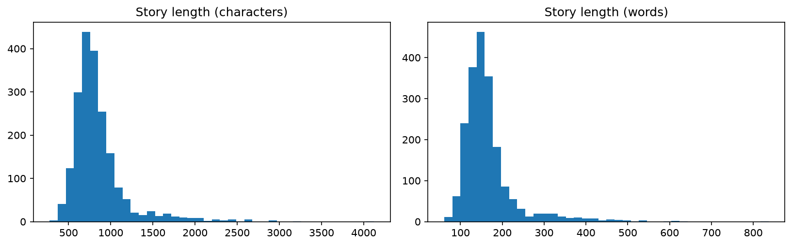
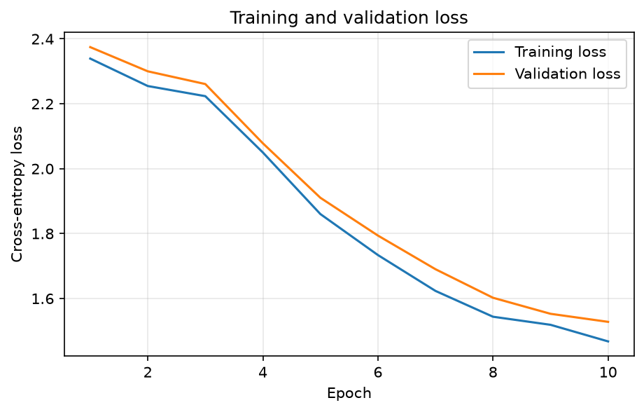
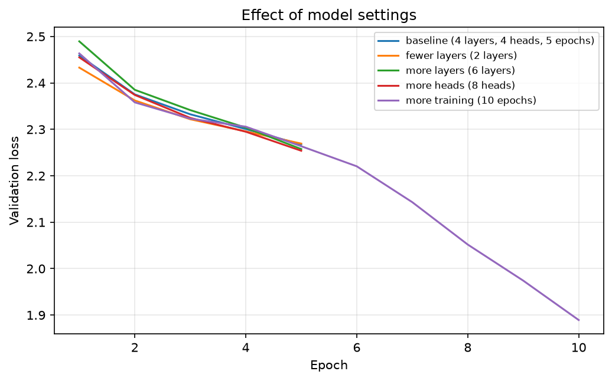

# Lab 3: Developing a Tiny Transformer Language Model

**Module:** PUSL 3205 - Large Language Models and Generative AI
**Tools:** Python, PyTorch, Hugging Face Datasets, Matplotlib, Gradio (optional)

## Objective
Build a small GPT-style Transformer from scratch, train it on a subset of the TinyStories dataset to predict the next character, evaluate it with loss and perplexity, and use it to generate short stories.

## Dataset
[roneneldan/TinyStories](https://huggingface.co/datasets/roneneldan/TinyStories) from Hugging Face: short, simple stories written in the vocabulary of a young child. I used the first 2,000 stories (90% for training, 10% for validation), loaded with streaming so the full dataset did not need to be downloaded. A typical story has about 850 characters (166 words) and 8 line breaks.

## What I did

1. **Loaded and explored the data.** Displayed sample stories and plotted story length in characters and words.
2. **Preprocessed the text.** Used character-level tokenization. The vocabulary has **80** unique characters, with 1,539,169 characters for training and 165,747 for validation.
3. **Prepared the training data.** Created input sequences of 128 characters (batch size 16), with targets shifted by one character for next-token prediction.
4. **Built the Transformer.** Token and positional embeddings, masked multi-head self-attention, feed-forward layers, residual connections and layer normalization.
5. **Initialized the model.** Set up the configuration below, the cross-entropy loss and the AdamW optimizer. The initial loss (4.377) matched random guessing (ln 80 = 4.382), which confirmed the model was set up correctly.
6. **Trained the model.** Forward pass, cross-entropy loss, backpropagation and parameter updates.
7. **Monitored training.** Recorded training and validation loss for each epoch and plotted the curves.
8. **Evaluated the model.** Calculated validation loss and perplexity.
9. **Generated stories** from prompts such as "Once upon a time", at different temperatures.
10. **Experimented with settings.** Changed the number of layers, attention heads and epochs.
11. **Saved the model** and its configuration in `saved_model/`.

## Model and training setup

| Setting | Value |
|---------|-------|
| Tokenization | Character level, vocabulary of 80 |
| Context length (block size) | 128 characters |
| Layers | 4 |
| Attention heads | 4 |
| Embedding size | 128 |
| Dropout | 0.1 |
| Parameters | 830,288 |
| Loss function | Cross-entropy |
| Optimizer | AdamW, learning rate 0.001, gradient clipping at 1.0 |
| Batch size | 16 |
| Main training run | 10 epochs of 100 steps (1,000 steps, about 17 minutes on a laptop CPU) |

One "epoch" here means 100 training steps on random windows of text, not one full pass over the data.

## Results

Baseline model:

| Metric | Value |
|--------|-------|
| Final training loss (epoch 10) | 1.468 |
| Final validation loss (epoch 10) | 1.528 |
| Validation loss (50-batch evaluation) | 1.522 |
| Perplexity | 4.58 |
| Random-guess perplexity (vocabulary size) | 80 |

Experiments (50 steps per epoch, so 250 steps for 5 epochs and 500 steps for 10 epochs):

| Experiment | Parameters | Validation loss | Perplexity |
|------------|-----------|-----------------|------------|
| Baseline (4 layers, 4 heads, 5 epochs) | 830,288 | 2.268 | 9.66 |
| Fewer layers (2) | 433,744 | 2.265 | 9.63 |
| More layers (6) | 1,226,832 | 2.272 | 9.70 |
| More heads (8) | 830,288 | 2.264 | 9.62 |
| More training (10 epochs) | 830,288 | 1.891 | 6.63 |

The experiment losses are higher than the main run because they trained for far fewer steps, so the two should not be compared directly.

### Plots







## Sample generated story

Prompt: `Once upon a time` (temperature 0.8, top-k 40)

```
Once upon a time, Mia happy was so the wanted it to had at the prand hears and wated the came. She can boy. She come was a becamed to come detch backed on the brost the with boted to the nevery backs.
```

The text looks like English at the level of letters, short words and punctuation, but it is not coherent. More samples at temperatures 0.5, 0.8 and 1.2 are in [outputs/generated_samples.txt](outputs/generated_samples.txt).

## Key observations
- **Training worked.** The training loss fell from 2.339 to 1.468 and the validation loss from 2.375 to 1.528 over 10 epochs. The two curves stayed close together (a gap of only about 0.03 to 0.07), so there was no sign of overfitting. The curves had not fully flattened, so longer training would probably help.
- **A perplexity of 4.58 is about 17 times better than random guessing (80)**, but the model is still uncertain between a few characters at each step.
- **Training length mattered more than model size.** Doubling the epochs from 5 to 10 cut the validation loss from 2.268 to 1.891. Changing the layers (2, 4 or 6) or heads (4 or 8) made almost no difference at this short training length. The 8-head model had the same number of parameters as the 4-head one, because heads split the same embedding instead of adding weights.
- **The generated text** contains real short words, capital letters, punctuation, quotation marks and names, but it has no grammar or meaning and includes invented words. A lower temperature (0.5) gave more readable but repetitive text, and a higher one (1.2) gave more random text.

## Mechanisms that improve performance
- **Self-attention and multi-head attention** let each position use earlier characters directly and look for different patterns at the same time.
- **Causal masking** stops the model from seeing future characters, so training matches the real task.
- **Positional embeddings** give the model the order of the characters.
- **Residual connections and layer normalization** keep training stable and let deeper models train.
- **Feed-forward layers** add processing power at every position.
- **Dropout, gradient clipping and AdamW** reduce overfitting and keep training stable.
- **More training, data and model size** lower the loss, and in my experiments more training helped the most.

## Limitations
- The model works at character level and is trained on only 2,000 stories for about 17 minutes on a CPU, so it learns spelling before grammar and its output is much weaker than a real language model.
- The experiments used a short training budget (250 steps), which limits what they can show about model size.
- Some TinyStories texts contain garbled characters (such as `’`), which the model copied.

## How to run
1. Install the libraries: `pip install torch datasets gradio matplotlib numpy`
2. Open `Labsheet03.ipynb` in Jupyter Notebook.
3. Select **Kernel → Restart & Run All**. The first run downloads the stories from Hugging Face, so it needs an internet connection. Training is slow on a CPU, so for a quick test lower `epochs` and `steps_per_epoch`.
4. Optional: run the last code cell to start the Gradio story generator.

## Folder contents
```
lab-03-tiny-transformer/
├── README.md
├── Labsheet03.ipynb
├── saved_model/
│   ├── tiny_transformer.pt
│   └── config.json
└── outputs/
    ├── story_length_hist.png
    ├── loss_curves.png
    ├── experiment_comparison.png
    └── generated_samples.txt
```
