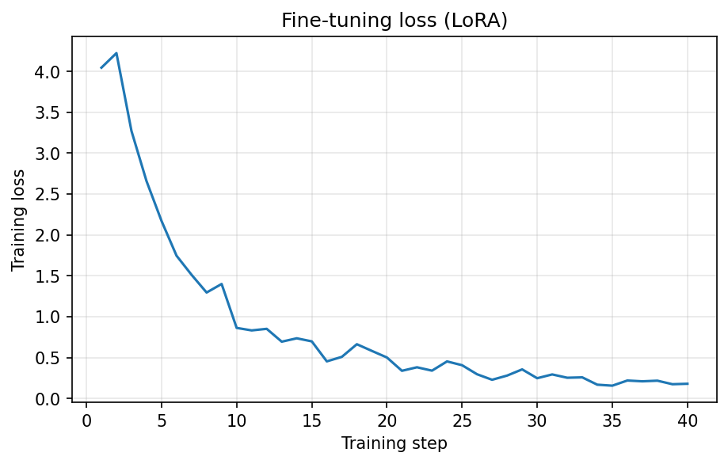

# Lab 4: Fine-Tuning an LLM using LoRA / QLoRA

**Module:** PUSL 3205 - Large Language Models and Generative AI
**Tools:** Python, Hugging Face Transformers, PEFT, TRL (SFTTrainer), bitsandbytes, Kaggle

## Objective
Fine-tune a small instruction-tuned language model on a custom question-and-answer dataset using LoRA / QLoRA, then compare the original model and the fine-tuned model on the same questions, including questions that were not in the training data.

## Setup
| Item | Value |
|------|-------|
| GPU | Tesla T4 (Kaggle) |
| GPU memory | 15.6 GB (compute capability 7.5) |
| Model | Qwen/Qwen2.5-0.5B-Instruct |
| Method | QLoRA: 4-bit NF4 quantization with LoRA adapters |
| Numeric precision | 32-bit calculations, no mixed precision (the T4 cannot train in bfloat16) |
| Libraries | torch 2.11.0+cu130, transformers 5.23.0, datasets 5.2.0, peft 0.21.3, trl 1.18.0, bitsandbytes, accelerate |

## Why a GPU?
Training a language model is mostly large matrix multiplications. A GPU performs thousands of these calculations in parallel, so it is far faster than a CPU. Its memory also limits the size of the model that can be loaded, which is why LoRA and 4-bit quantization are useful: they let a model train in the 15.6 GB available.

## Why this model?
The lab sheet suggests Qwen2.5-0.5B-Instruct (about 0.5 billion parameters) and SmolLM2-360M-Instruct (about 360 million). I chose Qwen2.5-0.5B-Instruct because it is already trained to follow instructions in a chat format and is slightly larger, so it may learn new facts more reliably, while still fitting easily on a free GPU.

## Dataset
A custom dataset of **40 question-and-answer pairs** about a fictional computer shop, **TechNest Computers**: opening hours, warranty, returns, delivery, payments, repairs, products and loyalty points. All shop details are invented for this lab, so the original model cannot know them. See [data/shop_qa_train.json](data/shop_qa_train.json).

Test set: **12 questions that are not in the training data** ([data/test_questions.json](data/test_questions.json)):
- 4 reworded versions of facts in the training data
- 4 questions that combine two facts
- 2 questions about facts that were never in the data
- 2 general-knowledge questions, to check the model was not damaged

## LoRA configuration
| Setting | Value |
|---------|-------|
| Rank (r) | 16 |
| lora_alpha | 32 |
| lora_dropout | 0.05 |
| Target modules | all linear layers |
| Trainable parameters | 8,798,208 of 502,830,976 (1.75%) |
| Saved adapter size | 46.7 MB |

## Training (SFTTrainer)
| Setting | Value |
|---------|-------|
| Epochs | 8 (40 training steps) |
| Batch size | 4 (gradient accumulation 2, effective batch 8) |
| Learning rate | 2e-4 (cosine schedule, 2 warm-up steps) |
| Max length | 512 tokens |
| Training time | 43 seconds |
| First loss to last loss | 4.045 to 0.180 |



The loss fell steeply in the first steps and flattened out near 0.2 by the end of training.

## Results: original vs fine-tuned

All 12 answers from both models are in [outputs/comparison.csv](outputs/comparison.csv) and [outputs/comparison.md](outputs/comparison.md). Answers were scored against the reference answers: "correct" means the answer matches the reference facts.

Examples:

| Question | Original model | Fine-tuned model |
|----------|----------------|------------------|
| What time do you close on Saturdays? (reference: 7:00 PM) | Invented closing times for New York and London | "The IT Help Desk is closed on Saturdays and Sundays." (wrong) |
| I'm at university. Can I get a cheaper laptop? (reference: yes, 10% student discount) | Refused to give advice | "No. Universities have their own laptops... OpenLaptopShop." (wrong) |
| How many loyalty points do I earn if I spend 250 dollars? (reference: 250 points) | Said it could not know, and described Amazon and Walmart | "Earning 1 point earns you 1 dollar." (wrong) |
| Do you have a branch in another city? (not in the data) | Answered as an AI assistant without inventing shop details | "Yes. TechNest Computers is located in South Kensington, London..." (invented) |

Scores:

| Question group | Original fully correct | Fine-tuned fully correct |
|----------------|------------------------|--------------------------|
| Reworded seen facts (4) | 0 | 0 |
| Combined facts (4) | 0 | 0 |
| Not in training data (2), scored as "did not invent shop facts" | 2 | 0 |
| General knowledge (2) | 2 | 1 (the RAM answer was shorter and partly inaccurate) |

Of the 8 shop-fact questions, the fine-tuned model started with the right "Yes" on 4 but gave wrong or contradictory details (the NestBook warranty, the faulty-laptop swap, the wireless mouse warranty and paying in parts), and was wrong on the other 4 (Saturday closing time, student discount, screen replacement cost and loyalty points). The original model gave no TechNest-specific correct fact.

## Key observations
- **Before fine-tuning,** the original model knew nothing about TechNest. It gave generic or invented answers (for example it treated NestBook as Google's Nest and said the mouse was bought from Alibaba Cloud) and often answered as an AI assistant.
- **After fine-tuning,** the behaviour changed clearly. The model answers briefly in the voice of the shop, often starting with "Yes." or "No.", and treats the questions as being about TechNest.
- **But it did not reliably learn the facts.** No shop-fact question was answered fully correctly. Examples: a 6-month laptop warranty instead of 12 months, 30 days of mouse cover instead of 6 months, "We don't accept returns for faulty devices" after "Yes", and 150 dollars for a screen replacement with express service where the correct cost is from 100 dollars (an 80 dollar screen plus a 20 dollar express fee).
- **It made up confident answers for facts that were not in the data,** such as a London branch and PlayStation stock. The original model did not claim any shop details.
- **General knowledge was mostly preserved** (Paris was correct), though the RAM answer became shorter and partly inaccurate.
- **A low training loss did not mean correct answers.** The loss fell from 4.045 to 0.180, but the model still failed on reworded questions. This suggests it memorised the training pairs instead of learning facts it can reuse. Likely reasons are the very small dataset, each fact appearing only once in one wording, and the small 0.5B model.

## Limitations
- The dataset is small and invented, so the model can memorise it and may not generalise well.
- Fine-tuning teaches the facts in the data, but it does not teach the model what it does not know, so it can still invent answers.
- For facts that change (prices, hours), looking them up in a database is usually better than fine-tuning.
- Training used 32-bit calculations on the T4. I did not compare other settings such as a different rank or more epochs.

## How to run
1. Open `Labsheet04.ipynb` in Kaggle or Google Colab and choose a T4 GPU (and turn Internet on in Kaggle).
2. Run the cells from the top, one at a time. The notebook installs the libraries, trains the adapter and creates the `outputs`, `data` and `lora_adapter` folders.
3. The last cell packs everything into `lab4_results.zip`.

## Folder contents
```
lab-04-lora-finetuning/
├── README.md
├── Labsheet04.ipynb
├── data/
│   ├── shop_qa_train.json
│   └── test_questions.json
├── outputs/
│   ├── gpu_info.txt
│   ├── loss_curve.png
│   ├── comparison.md
│   └── comparison.csv
└── lora_adapter/
    ├── adapter_config.json
    ├── adapter_model.safetensors
    └── tokenizer files
```
